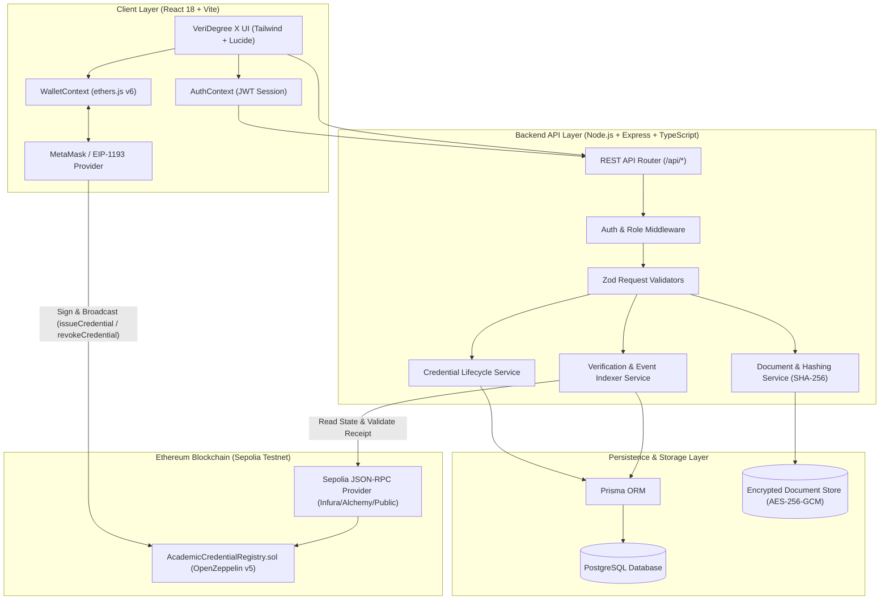

# VeriDegree X — System Architecture
**Version:** 1.0.0 (Production Blueprint)

---

## 1. High-Level System Architecture Diagram

---

## 2. Component Layer Responsibilities

### 2.1 Frontend Client
- **Presentation**: Preserves existing VeriDegree X pixel-perfect layout, dashboard metrics, and interactive simulation.
- **Wallet Connection**: Uses `ethers.js` v6 to detect MetaMask, verify Chain ID (`11155111` for Sepolia), request network switch, and display the connected address with truncated pill UI.
- **Transaction Signing**: University transactions (`issueCredential`, `revokeCredential`) are signed in the browser using the user's private key via MetaMask. The application NEVER requests or touches private keys.
- **Real-Time Feedback**: Shows transaction submission pending states, block confirmations, transaction receipts, and direct links to Sepolia Etherscan (`https://sepolia.etherscan.io/tx/{hash}`).

### 2.2 Node.js / Express Backend
- **Authentication & RBAC**: Issues JWT tokens stored in HttpOnly cookies or Authorization headers. Enforces strict role checks (`UNIVERSITY`, `STUDENT`, `RECRUITER`, `ADMIN`).
- **Cryptographic Document Processing**:
  - Validates uploaded PDF magic bytes (`%PDF-`).
  - Computes unforgeable SHA-256 hash over exact file bytes.
  - Computes deterministic RFC 8785 canonical metadata hash.
  - Stores encrypted PDF with a unique storage key in private storage.
- **On-Chain Event Reconciliation**:
  - Verifies that a transaction submitted by the frontend actually succeeded on Ethereum Sepolia.
  - Inspects transaction receipt status (`status === 1`) and decoded contract logs (`CredentialIssued` or `CredentialRevoked`).
  - Only marks records `ACTIVE` or `REVOKED` in PostgreSQL upon cryptographic confirmation.
- **Verification API**:
  - Serves public and recruiter verification requests.
  - Queries smart contract state independently via RPC.
  - Returns `VERIFIED`, `REVOKED`, `INVALID`, or `NOT_FOUND` with transparent cryptographic proof details.

### 2.3 Smart Contract Layer (`AcademicCredentialRegistry.sol`)
- **Authority**: Built on OpenZeppelin `AccessControl`.
- **Institution Whitelist**: Only authorized institutions can mint credentials.
- **State Storage**:
  - `credentialId` (bytes32)
  - `documentHash` (bytes32)
  - `metadataHash` (bytes32)
  - `issuer` (address)
  - `issuedAt` (uint256)
  - `exists` (bool)
  - `revoked` (bool)
- **Zero PII**: No personal data (student name, email, CGPA) is ever written to the public blockchain.

---

## 3. Data Privacy & Zero-Knowledge Architecture

1. **Student PII is strictly off-chain**: Names, enrollment IDs, grades, and PDFs reside solely in PostgreSQL and private encrypted storage.
2. **On-Chain Fingerprint**: Only 32-byte cryptographic digests (`documentHash` and `metadataHash`) are stored on Ethereum Sepolia.
3. **Public Verification**: Recruiters verify authenticity by submitting the Credential ID. The system matches the on-chain hash against the expected record without revealing unconsented academic transcripts.

