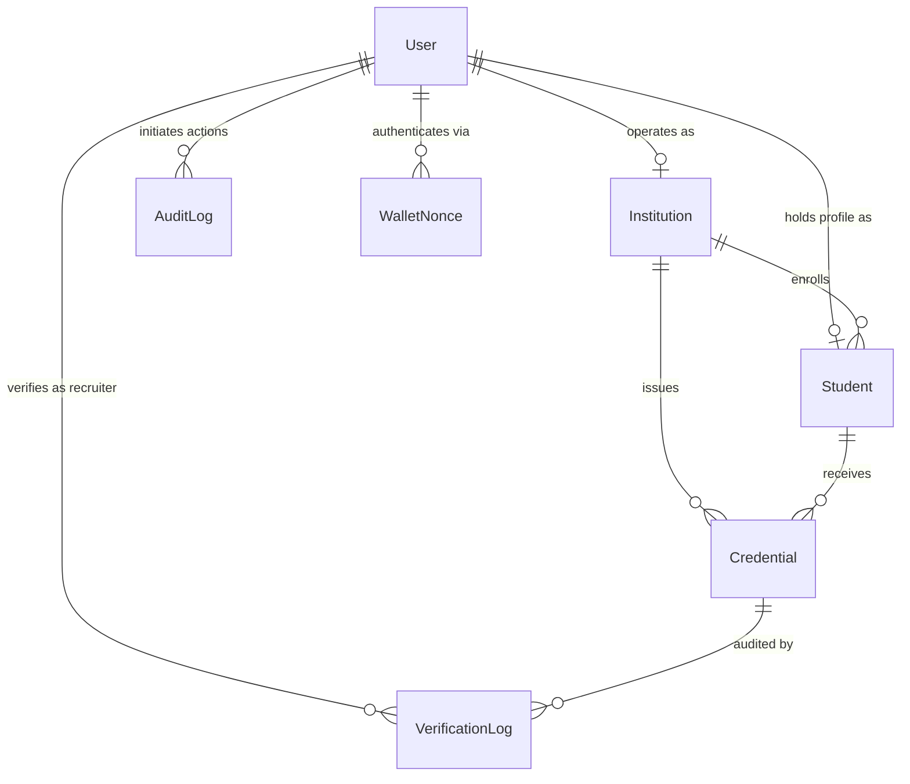

# VeriDegree X — Database Schema Specification
**Database:** PostgreSQL 15+  
**ORM:** Prisma 5.x / 6.x

---

## 1. Entity-Relationship Diagram

---

## 2. Table Specifications

### 2.1 `User`
| Column | Type | Constraints | Description |
|---|---|---|---|
| `id` | UUID | PRIMARY KEY, default `gen_random_uuid()` | Unique user identifier |
| `fullName` | VARCHAR(255) | NOT NULL | User's full name |
| `email` | VARCHAR(255) | UNIQUE, NOT NULL | Login and notification email |
| `passwordHash`| VARCHAR(255) | NOT NULL | Argon2id / bcrypt password digest |
| `role` | ENUM | NOT NULL | `UNIVERSITY`, `STUDENT`, `RECRUITER`, `ADMIN` |
| `walletAddress`| VARCHAR(42) | NULLABLE | Linked Ethereum checksum address |
| `isActive` | BOOLEAN | NOT NULL, DEFAULT true | Account status |
| `createdAt` | TIMESTAMP | NOT NULL, DEFAULT now() | Creation timestamp |
| `updatedAt` | TIMESTAMP | NOT NULL, DEFAULT now() | Last update timestamp |

### 2.2 `Institution`
| Column | Type | Constraints | Description |
|---|---|---|---|
| `id` | UUID | PRIMARY KEY, default `gen_random_uuid()` | Institution record ID |
| `userId` | UUID | UNIQUE, FOREIGN KEY -> User(id) | Associated user account |
| `institutionName`| VARCHAR(255) | NOT NULL | e.g. "Indian Institute of Technology Delhi" |
| `institutionCode`| VARCHAR(50) | UNIQUE, NOT NULL | e.g. "IITD" |
| `officialEmail` | VARCHAR(255) | NOT NULL | Official registrar contact email |
| `website` | VARCHAR(255) | NOT NULL | Official institution domain |
| `country` | VARCHAR(100) | NOT NULL, DEFAULT 'India' | Country of accreditation |
| `walletAddress` | VARCHAR(42) | UNIQUE, NOT NULL | On-chain authorized signer wallet |
| `blockchainRegistered` | BOOLEAN | NOT NULL, DEFAULT false | Whether whitelisted on-chain |
| `registrationTxHash` | VARCHAR(66) | NULLABLE | Transaction hash of whitelist approval |
| `createdAt` | TIMESTAMP | NOT NULL, DEFAULT now() | Created timestamp |
| `updatedAt` | TIMESTAMP | NOT NULL, DEFAULT now() | Updated timestamp |

### 2.3 `Student`
| Column | Type | Constraints | Description |
|---|---|---|---|
| `id` | UUID | PRIMARY KEY, default `gen_random_uuid()` | Student record ID |
| `userId` | UUID | UNIQUE, FOREIGN KEY -> User(id) | Associated student user account |
| `institutionId`| UUID | FOREIGN KEY -> Institution(id) | Issuing institution |
| `studentNumber`| VARCHAR(100)| NOT NULL | Institutional roll/enrollment number |
| `department` | VARCHAR(255) | NOT NULL | Academic department |
| `graduationYear`| INTEGER | NOT NULL | Year of degree conferral |
| `createdAt` | TIMESTAMP | NOT NULL, DEFAULT now() | Created timestamp |
| `updatedAt` | TIMESTAMP | NOT NULL, DEFAULT now() | Updated timestamp |

### 2.4 `Credential`
| Column | Type | Constraints | Description |
|---|---|---|---|
| `id` | UUID | PRIMARY KEY, default `gen_random_uuid()` | Internal credential primary key |
| `credentialId` | VARCHAR(64) | UNIQUE, NOT NULL | Public identifier e.g. "VDX-2024-IITD-0891" |
| `studentId` | UUID | FOREIGN KEY -> Student(id) | Recipient student |
| `institutionId` | UUID | FOREIGN KEY -> Institution(id) | Conferring university |
| `degreeName` | VARCHAR(255) | NOT NULL | e.g. "B.Tech in Computer Science & Engineering" |
| `department` | VARCHAR(255) | NOT NULL | Academic department |
| `graduationYear` | INTEGER | NOT NULL | Year of conferral |
| `grade` | VARCHAR(100) | NOT NULL | e.g. "CGPA: 9.62 (Gold Medal)" |
| `issueDate` | DATE | NOT NULL | Official issue date |
| `documentStorageKey`| VARCHAR(255)| NOT NULL | Private object storage key |
| `documentHash` | VARCHAR(66) | NOT NULL | Hex SHA-256 binary hash of the PDF |
| `metadataHash` | VARCHAR(66) | NOT NULL | Hex SHA-256 of canonical metadata |
| `issuerWallet` | VARCHAR(42) | NOT NULL | Issuer Ethereum address |
| `blockchainTxHash` | VARCHAR(66) | NULLABLE | Mint transaction hash on Sepolia |
| `blockchainNetwork`| VARCHAR(50) | NOT NULL, DEFAULT 'sepolia' | Target network |
| `status` | ENUM | NOT NULL, DEFAULT 'PENDING' | `PENDING`, `ACTIVE`, `REVOKED`, `FAILED` |
| `revokedAt` | TIMESTAMP | NULLABLE | Timestamp of revocation |
| `revocationReason` | TEXT | NULLABLE | Reason decree |
| `revocationTxHash` | VARCHAR(66) | NULLABLE | Revocation transaction hash on Sepolia |
| `createdAt` | TIMESTAMP | NOT NULL, DEFAULT now() | Creation timestamp |
| `updatedAt` | TIMESTAMP | NOT NULL, DEFAULT now() | Last update timestamp |

### 2.5 `VerificationLog`
| Column | Type | Constraints | Description |
|---|---|---|---|
| `id` | UUID | PRIMARY KEY, default `gen_random_uuid()` | Verification record ID |
| `credentialId` | VARCHAR(64) | FOREIGN KEY -> Credential(credentialId) | Audited credential |
| `verifierUserId` | UUID | NULLABLE, FOREIGN KEY -> User(id) | Recruiter user if authenticated |
| `verificationResult`| VARCHAR(50) | NOT NULL | `VERIFIED`, `REVOKED`, `INVALID`, `NOT_FOUND` |
| `verificationMethod`| VARCHAR(50) | NOT NULL | `QR_SCAN`, `MANUAL_ID`, `API` |
| `transactionHash` | VARCHAR(66) | NULLABLE | On-chain transaction reference |
| `verifiedAt` | TIMESTAMP | NOT NULL, DEFAULT now() | Audit timestamp |

### 2.6 `WalletNonce`
| Column | Type | Constraints | Description |
|---|---|---|---|
| `id` | UUID | PRIMARY KEY, default `gen_random_uuid()` | Nonce ID |
| `walletAddress` | VARCHAR(42) | NOT NULL | EIP-55 address requesting authentication |
| `nonce` | VARCHAR(64) | UNIQUE, NOT NULL | Cryptographic random hex nonce |
| `expiresAt` | TIMESTAMP | NOT NULL | Expiry window (e.g. 5 minutes) |
| `usedAt` | TIMESTAMP | NULLABLE | Consumption timestamp for replay prevention |

### 2.7 `AuditLog`
| Column | Type | Constraints | Description |
|---|---|---|---|
| `id` | UUID | PRIMARY KEY, default `gen_random_uuid()` | Audit log ID |
| `actorUserId` | UUID | NULLABLE, FOREIGN KEY -> User(id) | User who executed the action |
| `action` | VARCHAR(100) | NOT NULL | e.g. `ISSUE_CREDENTIAL`, `REVOKE_CREDENTIAL` |
| `entityType` | VARCHAR(50) | NOT NULL | e.g. `CREDENTIAL`, `INSTITUTION` |
| `entityId` | VARCHAR(100) | NOT NULL | Target entity ID |
| `metadata` | JSONB | NULLABLE | Action payload snapshot |
| `createdAt` | TIMESTAMP | NOT NULL, DEFAULT now() | Timestamp |

